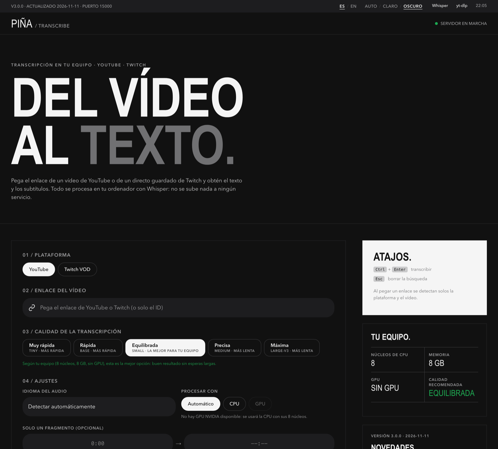
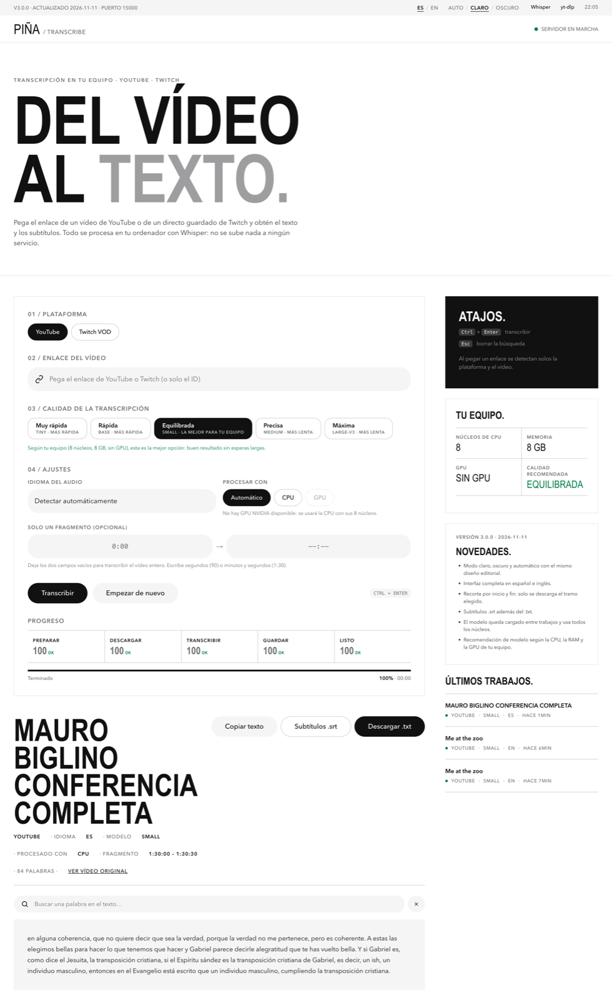

<p align="center">
  
</p>

<h1 align="center">Piña Transcribe</h1>

<p align="center">
  <b>From video to text, without leaving your machine.</b><br/>
  Transcripts and subtitles for YouTube and Twitch VODs with Whisper, 100% local.
</p>

<p align="center">
  <a href="README.md">Español</a> · <b>English</b>
</p>

<p align="center">
  
  
  
  
</p>

<p align="center">
  <a href="#getting-started">Getting started</a> ·
  <a href="#which-model-should-i-pick">Models</a> ·
  <a href="#command-line">CLI</a> ·
  <a href="#configuration">Configuration</a> ·
  <a href="#api">API</a> ·
  <a href="CHANGELOG.md">Changelog</a>
</p>

<p align="center">
  <picture>
    <source media="(prefers-color-scheme: dark)" srcset="docs/screenshots/dark-en.png"/>
    
  </picture>
  <br/><sub>The screenshot follows the light or dark theme you are viewing GitHub with.</sub>
</p>

---

## What it does

Paste a YouTube or Twitch VOD link and get the full text plus a subtitle file. Audio is fetched with [yt‑dlp](https://github.com/yt-dlp/yt-dlp) and transcribed with [faster‑whisper](https://github.com/SYSTRAN/faster-whisper) on your own computer: no accounts, no telemetry, nothing uploaded to third parties.

| | |
|---|---|
| **Light, dark or automatic** | Follows your system theme or pick one; remembered by the browser. |
| **Spanish and English** | The whole interface, including progress and error messages. |
| **Start/end trimming** | Transcribe just a range (`1:30` → `4:00`). Only that part is downloaded, great for multi-hour streams. |
| **`.txt` and `.srt`** | Text with metadata, and subtitles timed to the original video. |
| **Adapts to your machine** | Detects CPU threads, memory and GPU, and recommends the right model. |
| **Fast back-to-back jobs** | The model stays loaded in memory and audio is converted to 16 kHz mono. |
| **Runs anywhere** | Docker for `amd64` and `arm64` (PCs, servers, Apple Silicon Macs, Raspberry Pi 4/5), optional NVIDIA GPU profile, or native Python on Linux, macOS and Windows. |

## Screenshots

<table>
  <tr>
    <td></td>
    <td></td>
  </tr>
  <tr>
    <td align="center">Light mode · English</td>
    <td align="center">Dark mode · Spanish</td>
  </tr>
</table>

<p align="center">
  
</p>

## Getting started

### With Docker (recommended)

```bash
git clone https://github.com/webcvalejandropina-ui/pina-transcribe.git
cd pina-transcribe
docker compose up -d --build transcribe
```

Open **http://127.0.0.1:15000**. The first transcription downloads the chosen model and keeps it in a volume for next time.

Or use the launcher, which reads `pina.env` if present:

```bash
python3 launch_docker.py          # macOS / Linux  (or ./launch.sh)
launch.cmd                        # Windows
python3 launch_docker.py --gpu    # with an NVIDIA GPU
```

### With an NVIDIA GPU

Requires the [NVIDIA Container Toolkit](https://docs.nvidia.com/datacenter/cloud-native/container-toolkit/latest/install-guide.html):

```bash
docker compose --profile gpu up -d --build transcribe-gpu
```

Leave the processor on **Auto** in the interface and the GPU is used when available; if it fails, it falls back to CPU automatically.

### Without Docker

You need Python 3.10+ and `ffmpeg` on your `PATH` (`brew install ffmpeg`, `sudo apt install ffmpeg` or `winget install ffmpeg`).

```bash
python3 -m venv venv
source venv/bin/activate            # Windows: venv\Scripts\activate
pip install -r requirements.txt
python -m uvicorn web_server:app --host 127.0.0.1 --port 15000
```

## Which model should I pick?

When the interface opens it detects your GPU, cores and memory: the best quality is preselected, anything that won't fit in memory is disabled and you're warned when an option will be slow. As a guide:

| Quality | Approx. memory | Best for |
|---|---|---|
| Very fast · `tiny` | ~1 GB | Very modest machines, quick tests |
| Fast · `base` | ~1.5 GB | 4-core laptops, good balance |
| Balanced · `small` | ~2.5 GB | 6+ core CPUs with 8 GB RAM |
| Accurate · `medium` | ~4 GB | More accuracy if you can wait |
| Maximum · `large-v3` | ~6 GB | NVIDIA GPUs, or lots of patience on CPU |

The `.en` variants (`base.en`, `small.en`…) are available through the API and CLI and do slightly better on English-only audio.

## Command line

```bash
python transcribe.py youtube dQw4w9WgXcQ
python transcribe.py twitch 1234567890 --model small --lang es
python transcribe.py youtube dQw4w9WgXcQ --start 1:30 --end 4:00
docker compose run --rm transcribe youtube dQw4w9WgXcQ --model base
docker compose run --rm -it transcribe launcher      # interactive wizard
```

| Option | Description |
|---|---|
| `--model NAME` | Whisper model (default `tiny`). |
| `--lang CODE` | Fixed language (`es`, `en`…); detected when omitted. |
| `--start` / `--end` | Range to transcribe: seconds, `mm:ss` or `hh:mm:ss`. |
| `--cpu` | Force CPU even if a GPU is available. |
| `--no-color` | Plain output without colours. |

## Configuration

Copy `pina.env.example` to `pina.env` and adjust it. The launcher loads it automatically; with Compose by hand, run `docker compose --env-file pina.env up -d`.

| Variable | Default | Purpose |
|---|---|---|
| `BIND_ADDRESS` | `127.0.0.1` | `0.0.0.0` to open it to a trusted local network. |
| `PINA_PORT` | `15000` | Published port. |
| `PINA_MEM_LIMIT` | `6g` | Container memory cap; if exceeded, only this service stops. |
| `PINA_CPU_THREADS` | all | CPU threads for Whisper. |
| `PINA_KEEP_MODEL` | `1` | `0` frees the model's RAM after every job. |
| `YTDLP_PROXY` | empty | Proxy for yt‑dlp if YouTube rate-limits your IP. |
| `YTDLP_COOKIES_FILE` | empty | Path (inside the container) to a Netscape cookies file. |

> `pina.env` and cookie files are personal: never commit them to a repository.

## API

One job at a time so the machine isn't overloaded. Errors return a stable `code` (`invalid_source`, `busy`, `forbidden`…).

| Method | Path | Description |
|---|---|---|
| `GET` | `/health` | Status and version. |
| `GET` | `/api/system` | CPU, memory, GPU and recommended model. |
| `POST` | `/api/jobs` | Create a job. |
| `GET` | `/api/jobs/{id}` | Status, progress and result. |
| `GET` | `/api/jobs/{id}/download?format=txt\|srt` | Download the text or the subtitles. |

```json
{
  "platform": "youtube",
  "video_id": "https://youtu.be/dQw4w9WgXcQ",
  "model": "small",
  "lang": "en",
  "device": "auto",
  "start": "1:30",
  "end": "4:00"
}
```

## Privacy and security

- The interface loads no third-party fonts, scripts or images, and there is no analytics.
- Strict CSP with no inline scripts, plus `X-Frame-Options`, `Referrer-Policy` and `Permissions-Policy`.
- Swagger, ReDoc and OpenAPI are disabled.
- URLs are reduced to a validated ID; arbitrary links are never downloaded.
- The container runs as non-root, with a read-only filesystem, no Linux capabilities and a memory cap.
- It only listens on `127.0.0.1` by default. Don't expose it to the Internet: it has no authentication.

## Output files

| Path | Contents |
|---|---|
| `outputs/<ID>.txt` | Metadata and transcript. With trimming: `<ID>_<start>-<end>.txt`. |
| `outputs/<ID>.srt` | Subtitles timed to the original video. |
| `logs/transcribe.log` | Run log (CLI). |

With Docker they live in the `outputs-data`, `logs-data` and `model-cache` volumes.

## Troubleshooting

| Symptom | What to do |
|---|---|
| `HTTP 403` from YouTube | Rebuild the image (`docker compose build --pull transcribe`). If it persists, set `YTDLP_COOKIES_FILE` or `YTDLP_PROXY`. |
| Container restarts with large models | Raise `PINA_MEM_LIMIT` or pick a smaller model. |
| GPU not detected | Check `nvidia-smi` and the NVIDIA Container Toolkit; otherwise use the CPU service. |
| `ffmpeg` not found (without Docker) | Install it and check `ffmpeg -version`. |
| Certificate errors when downloading ranges (macOS) | Handled using the `certifi` bundle; behind a corporate proxy, set `SSL_CERT_FILE`. |

## Project layout

```text
pina-transcribe/
├── web_server.py          FastAPI API and interface server
├── web/                   Interface: HTML, CSS, JS and ES/EN strings
├── utils/                 Download, transcription, trimming and machine info
├── transcribe.py          CLI
├── launcher.py            Interactive console wizard
├── launch_docker.py       Cross-platform Docker launcher (+ launch.sh / launch.cmd)
├── Dockerfile             CPU image (amd64/arm64)
├── Dockerfile.gpu         CUDA image (amd64)
├── docker-compose.yml
├── DESIGN.md            Interface design system
├── pina.env.example       Configuration template
├── tests/
└── docs/screenshots/
```

Tests: `python -m unittest -v`

## License

Personal and educational use. Respect the YouTube and Twitch terms, the copyright of the content and the licences of Whisper and the other dependencies.

[Changelog](CHANGELOG.md)
