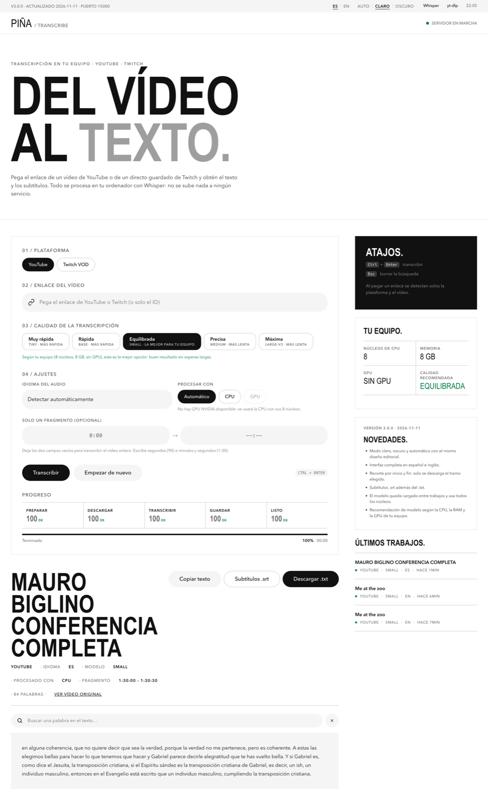
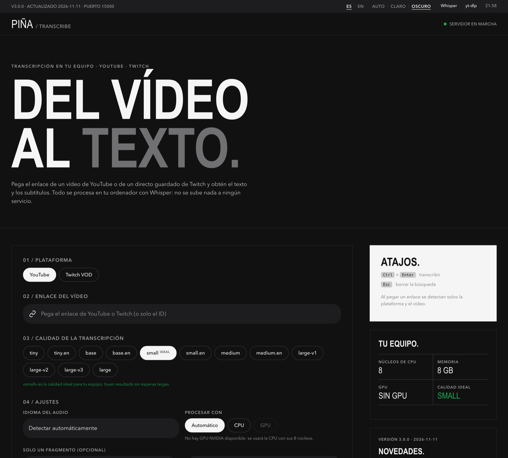
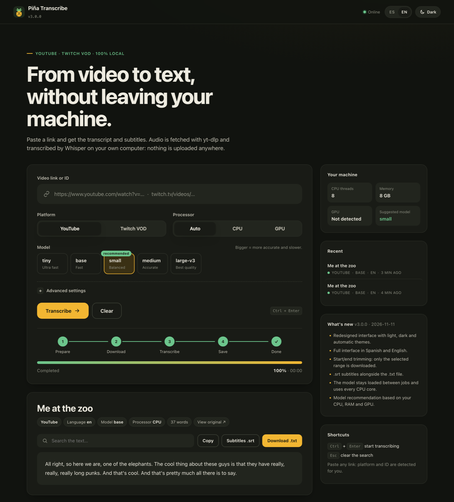

<p align="center">
  
</p>

<h1 align="center">Piña Transcribe</h1>

<p align="center">
  <b>De vídeo a texto, sin salir de tu máquina.</b><br/>
  Transcripción y subtítulos de YouTube y Twitch VOD con Whisper, 100 % en local.
</p>

<p align="center">
  <b>Español</b> · <a href="README.en.md">English</a>
</p>

<p align="center">
  
  
  
  
</p>

<p align="center">
  <a href="#puesta-en-marcha">Puesta en marcha</a> ·
  <a href="#qué-modelo-elijo">Modelos</a> ·
  <a href="#línea-de-comandos">CLI</a> ·
  <a href="#configuración">Configuración</a> ·
  <a href="#api">API</a> ·
  <a href="CHANGELOG.md">Cambios</a>
</p>

<p align="center">
  <picture>
    <source media="(prefers-color-scheme: dark)" srcset="docs/screenshots/home-dark-es.png"/>
    
  </picture>
  <br/><sub>La captura sigue el tema claro u oscuro con el que estés viendo GitHub.</sub>
</p>

---

## Qué hace

Pegas un enlace de YouTube o de un VOD de Twitch y obtienes el texto completo y un archivo de subtítulos. El audio se descarga con [yt‑dlp](https://github.com/yt-dlp/yt-dlp) y se transcribe con [faster‑whisper](https://github.com/SYSTRAN/faster-whisper) en tu propio equipo: no hay cuentas, ni telemetría, ni nada que se suba a terceros.

| | |
|---|---|
| **Claro, oscuro o automático** | Sigue el tema del sistema o elige uno; se recuerda en el navegador. |
| **Español e inglés** | Toda la interfaz, mensajes de progreso y errores incluidos. |
| **Recorte por inicio y fin** | Transcribe solo un tramo (`1:30` → `4:00`). Solo se descarga ese fragmento, ideal para directos de varias horas. |
| **`.txt` y `.srt`** | Texto con metadatos y subtítulos con marcas de tiempo del vídeo original. |
| **Se adapta a tu equipo** | Detecta hilos de CPU, memoria y GPU, y recomienda el modelo adecuado. |
| **Rápido en trabajos seguidos** | El modelo queda cargado en memoria y el audio se convierte a 16 kHz mono. |
| **Cualquier máquina** | Docker para `amd64` y `arm64` (PC, servidores, Mac Apple Silicon, Raspberry Pi 4/5), perfil GPU NVIDIA opcional, o Python nativo en Linux, macOS y Windows. |

## Capturas

<table>
  <tr>
    <td></td>
    <td></td>
  </tr>
  <tr>
    <td align="center">Modo oscuro · Español</td>
    <td align="center">Modo claro · Inglés</td>
  </tr>
</table>

<p align="center">
  
</p>

## Puesta en marcha

### Con Docker (recomendado)

```bash
git clone https://github.com/webcvalejandropina-ui/pina-transcribe.git
cd pina-transcribe
docker compose up -d --build transcribe
```

Abre **http://127.0.0.1:15000**. La primera transcripción descarga el modelo elegido y lo guarda en un volumen para las siguientes.

También puedes usar el lanzador, que lee `pina.env` si existe:

```bash
python3 launch_docker.py          # macOS / Linux  (o ./launch.sh)
launch.cmd                        # Windows
python3 launch_docker.py --gpu    # con GPU NVIDIA
```

### Con GPU NVIDIA

Requiere [NVIDIA Container Toolkit](https://docs.nvidia.com/datacenter/cloud-native/container-toolkit/latest/install-guide.html):

```bash
docker compose --profile gpu up -d --build transcribe-gpu
```

En la interfaz, deja el procesador en **Auto** y se usará la GPU si está disponible; si falla, cae a CPU automáticamente.

### Sin Docker

Necesitas Python 3.10+ y `ffmpeg` en el `PATH` (`brew install ffmpeg`, `sudo apt install ffmpeg` o `winget install ffmpeg`).

```bash
python3 -m venv venv
source venv/bin/activate            # Windows: venv\Scripts\activate
pip install -r requirements.txt
python -m uvicorn web_server:app --host 127.0.0.1 --port 15000
```

## ¿Qué modelo elijo?

La tarjeta **Tu equipo** de la interfaz sugiere uno automáticamente. Como referencia:

| Modelo | Memoria aprox. | Ideal para |
|---|---|---|
| `tiny` | ~1 GB | Equipos muy modestos, pruebas rápidas |
| `base` | ~1,5 GB | Portátiles de 4 núcleos, buen equilibrio |
| `small` | ~2,5 GB | CPU de 6+ núcleos y 8 GB de RAM |
| `medium` | ~4 GB | Más precisión si no importa esperar |
| `large-v3` | ~6 GB | GPU NVIDIA o mucha paciencia en CPU |

Las variantes `.en` (`base.en`, `small.en`…) están disponibles por API y CLI y van algo mejor con audio solo en inglés.

## Línea de comandos

```bash
python transcribe.py youtube dQw4w9WgXcQ
python transcribe.py twitch 1234567890 --model small --lang es
python transcribe.py youtube dQw4w9WgXcQ --start 1:30 --end 4:00
docker compose run --rm transcribe youtube dQw4w9WgXcQ --model base
docker compose run --rm -it transcribe launcher      # asistente interactivo
```

| Opción | Descripción |
|---|---|
| `--model NOMBRE` | Modelo de Whisper (por defecto `tiny`). |
| `--lang CÓDIGO` | Idioma fijo (`es`, `en`…); si se omite, se detecta. |
| `--start` / `--end` | Tramo a transcribir: segundos, `mm:ss` o `hh:mm:ss`. |
| `--cpu` | Fuerza CPU aunque haya GPU. |
| `--no-color` | Salida sin colores. |

## Configuración

Copia `pina.env.example` como `pina.env` y ajusta lo que necesites. El lanzador lo carga solo; con Compose a mano, usa `docker compose --env-file pina.env up -d`.

| Variable | Por defecto | Para qué sirve |
|---|---|---|
| `BIND_ADDRESS` | `127.0.0.1` | `0.0.0.0` para abrirlo a tu red local de confianza. |
| `PINA_PORT` | `15000` | Puerto publicado. |
| `PINA_MEM_LIMIT` | `6g` | Memoria máxima del contenedor; si se supera, solo se detiene este servicio. |
| `PINA_CPU_THREADS` | todos | Hilos de CPU para Whisper. |
| `PINA_KEEP_MODEL` | `1` | `0` libera la RAM del modelo al acabar cada trabajo. |
| `YTDLP_PROXY` | vacío | Proxy para yt‑dlp si YouTube limita tu IP. |
| `YTDLP_COOKIES_FILE` | vacío | Ruta (dentro del contenedor) a un archivo de cookies Netscape. |

> `pina.env` y los archivos de cookies son personales: no los subas a ningún repositorio.

## API

Un trabajo a la vez para no saturar la máquina. Los errores devuelven un `code` estable (`invalid_source`, `busy`, `forbidden`…).

| Método | Ruta | Descripción |
|---|---|---|
| `GET` | `/health` | Estado y versión. |
| `GET` | `/api/system` | CPU, memoria, GPU y modelo recomendado. |
| `POST` | `/api/jobs` | Crea un trabajo. |
| `GET` | `/api/jobs/{id}` | Estado, progreso y resultado. |
| `GET` | `/api/jobs/{id}/download?format=txt\|srt` | Descarga el texto o los subtítulos. |

```json
{
  "platform": "youtube",
  "video_id": "https://youtu.be/dQw4w9WgXcQ",
  "model": "small",
  "lang": "es",
  "device": "auto",
  "start": "1:30",
  "end": "4:00"
}
```

## Privacidad y seguridad

- La interfaz no carga fuentes, scripts ni imágenes de terceros, y no hay analítica.
- CSP estricta sin scripts en línea, `X-Frame-Options`, `Referrer-Policy` y `Permissions-Policy`.
- Swagger, ReDoc y OpenAPI desactivados.
- Las URLs se reducen a un ID validado; no se descargan enlaces arbitrarios.
- El contenedor corre sin root, con sistema de archivos de solo lectura, sin capacidades Linux y con límite de memoria.
- Por defecto solo escucha en `127.0.0.1`. No lo expongas a Internet: no tiene autenticación.

## Archivos generados

| Ruta | Contenido |
|---|---|
| `outputs/<ID>.txt` | Metadatos y transcripción. Con recorte: `<ID>_<inicio>-<fin>.txt`. |
| `outputs/<ID>.srt` | Subtítulos con los tiempos del vídeo original. |
| `logs/transcribe.log` | Registro de ejecución (CLI). |

En Docker viven en los volúmenes `outputs-data`, `logs-data` y `model-cache`.

## Solución de problemas

| Síntoma | Qué hacer |
|---|---|
| `HTTP 403` de YouTube | Reconstruye la imagen (`docker compose build --pull transcribe`). Si persiste, configura `YTDLP_COOKIES_FILE` o `YTDLP_PROXY`. |
| El contenedor se reinicia con modelos grandes | Sube `PINA_MEM_LIMIT` o usa un modelo más pequeño. |
| GPU no detectada | Comprueba `nvidia-smi` y NVIDIA Container Toolkit; si no, usa el servicio CPU. |
| `ffmpeg` no encontrado (sin Docker) | Instálalo y comprueba `ffmpeg -version`. |
| Error de certificados al descargar tramos (macOS) | Ya se gestiona usando el bundle de `certifi`; si tienes un proxy corporativo, define `SSL_CERT_FILE`. |

## Estructura

```text
pina-transcribe/
├── web_server.py          API FastAPI y servidor de la interfaz
├── web/                   Interfaz: HTML, CSS, JS y textos ES/EN
├── utils/                 Descarga, transcripción, recorte y datos del equipo
├── transcribe.py          CLI
├── launcher.py            Asistente interactivo en consola
├── launch_docker.py       Lanzador Docker multiplataforma (+ launch.sh / launch.cmd)
├── Dockerfile             Imagen CPU (amd64/arm64)
├── Dockerfile.gpu         Imagen CUDA (amd64)
├── docker-compose.yml
├── pina.env.example       Plantilla de configuración
├── tests/
└── docs/screenshots/
```

Pruebas: `python -m unittest -v`

## Licencia

Uso personal y educativo. Respeta los términos de YouTube y Twitch, los derechos de autor del contenido y las licencias de Whisper y del resto de dependencias.

[Historial de cambios](CHANGELOG.md)
